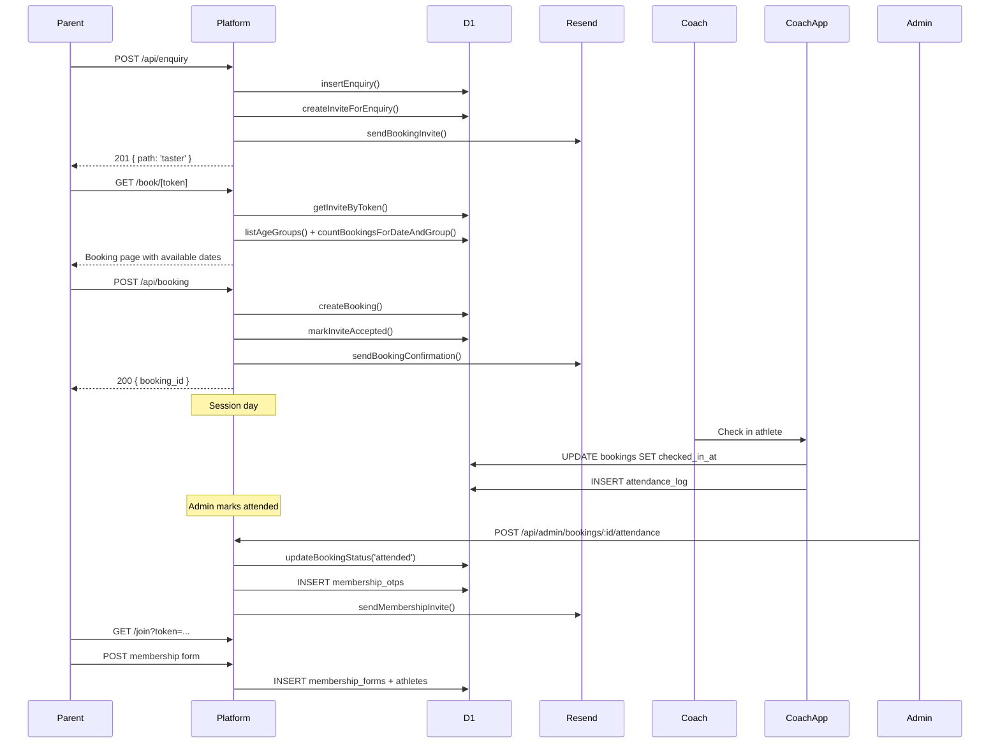
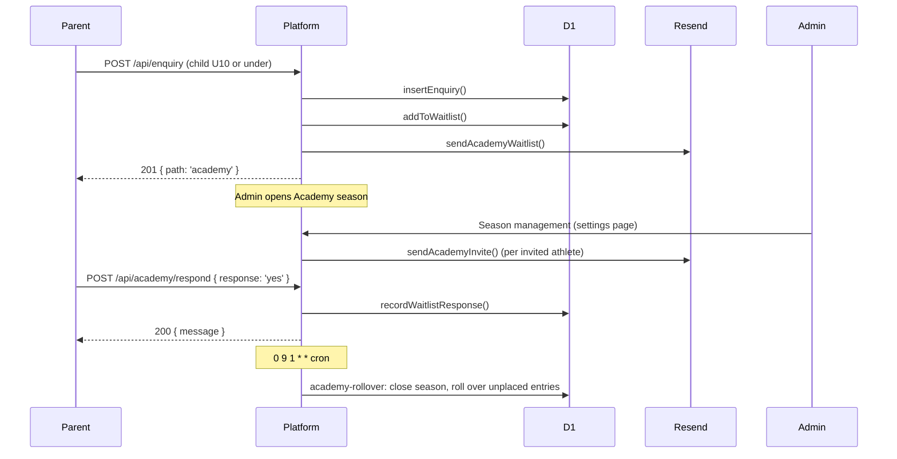
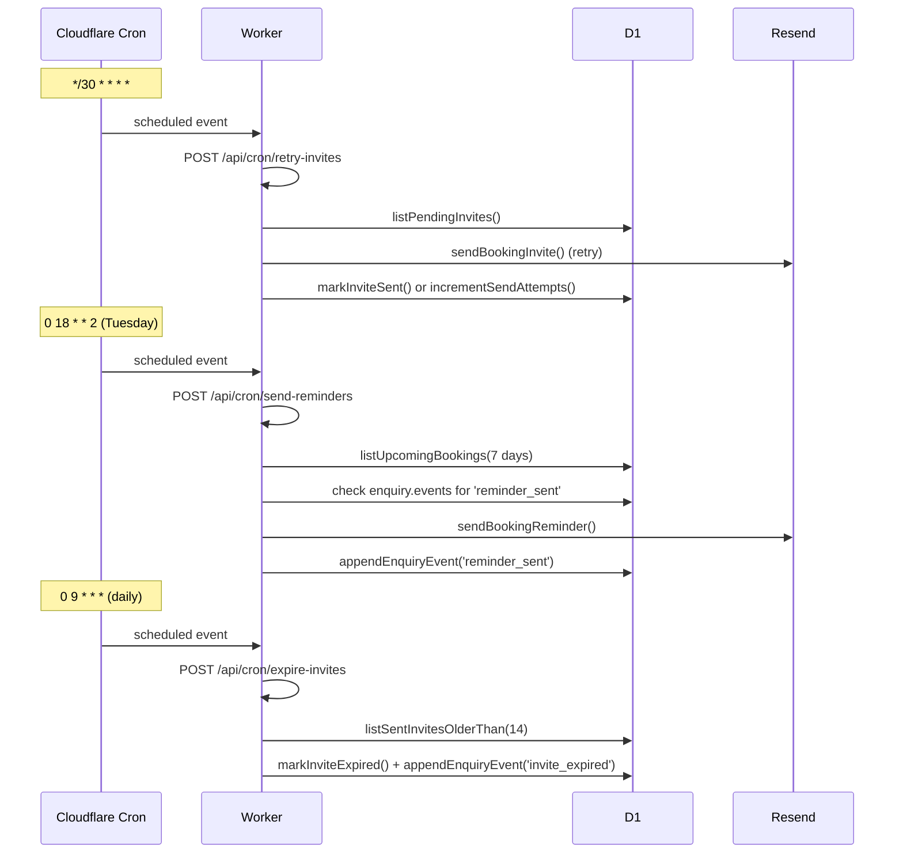

# EGAC Platform — Architecture

*East Grinstead Athletics Club · Built on Cloudflare Pages + Workers + D1 + KV + Resend*

---

## Overview

The EGAC platform is a bespoke SaaS application for managing junior athletics club enquiries, taster session bookings, Academy waitlist, and member attendance. It runs entirely on Cloudflare's free tier at the expected usage volume for a club of this size.

```
┌─────────────────────────────────────────────────────────────┐
│                    Cloudflare Edge                           │
│                                                             │
│  ┌───────────────┐    ┌───────────────┐    ┌─────────────┐ │
│  │  Cloudflare   │    │  Cloudflare   │    │  Cloudflare │ │
│  │    Pages      │    │    Workers    │    │    Access   │ │
│  │  (Astro SSR)  │───▶│  (API routes) │    │ (coach app) │ │
│  └───────────────┘    └───────┬───────┘    └─────────────┘ │
│                               │                             │
│              ┌────────────────┼────────────┐                │
│              ▼                ▼            ▼                │
│         ┌─────────┐    ┌──────────┐  ┌─────────┐           │
│         │   D1    │    │    KV    │  │ Resend  │           │
│         │ SQLite  │    │  Cache   │  │  Email  │           │
│         └─────────┘    └──────────┘  └─────────┘           │
└─────────────────────────────────────────────────────────────┘
```

---

## Component Map

### Cloudflare Pages (Astro SSR)

Hosts all public-facing and admin pages as server-rendered Astro components. Each page runs as a Cloudflare Worker via the `@astrojs/cloudflare` adapter.

| Path | Purpose |
|---|---|
| `/` | Public enquiry form |
| `/book/[token]` | Token-gated taster booking page |
| `/academy/respond/[token]` | Academy waitlist acceptance/decline |
| `/join` | Membership form (OTP-gated) |
| `/admin/*` | Admin portal (cookie-auth) |

### Cloudflare Workers (API routes)

All `/api/*` routes are handled by a single router in `src/api/router.ts`, exported as a Cloudflare Worker and called via the Astro catch-all `src/pages/api/[...path].ts`.

**Public routes** (no auth):
```
POST /api/enquiry              Register interest → route to taster or Academy
POST /api/booking              Book a taster session (invite token required)
POST /api/academy/respond      Accept/decline Academy waitlist invitation
GET  /api/health               Liveness check — D1 + KV + email key
```

**Cron routes** (`Authorization: Bearer CRON_SECRET`):
```
POST /api/cron/expire-invites     Mark stale invites as expired (daily)
POST /api/cron/retry-invites      Retry pending invite sends (every 30 min)
POST /api/cron/send-reminders     Send session reminders (Tuesday 18:00)
POST /api/cron/academy-rollover   Roll over unplaced waitlist (1st of month)
```

**Admin routes** (`Authorization: Bearer ADMIN_TOKEN`):
```
GET/POST   /api/admin/enquiries
GET/PATCH  /api/admin/enquiries/:id
POST       /api/admin/invites/resend
GET        /api/admin/bookings
POST       /api/admin/bookings/:id/attendance
GET        /api/admin/reports
GET/POST   /api/admin/templates
GET/PATCH  /api/admin/templates/:id
GET        /api/admin/templates/:id/preview
POST       /api/admin/templates/:id/test-send
GET/POST   /api/admin/memberships
```

### Cloudflare D1 (SQLite)

Primary datastore. All queries use `?` placeholders and include `AND environment = ?` for row-level isolation between development, staging, and production.

**Tables:**

| Table | Purpose |
|---|---|
| `enquiries` | Every registration — parent/athlete details, event log |
| `invites` | Booking invite tokens — one per enquiry, reusable |
| `bookings` | Confirmed taster session bookings |
| `age_groups` | Configurable age group boundaries and session times |
| `academy_seasons` | Academy programme seasons |
| `academy_waitlist` | Academy waitlist entries with response tracking |
| `email_templates` | Editable email templates with `{{variable}}` substitution |
| `membership_otps` | One-time tokens for membership form access |
| `membership_forms` | Submitted membership form payloads (JSON) |
| `athletes` | Active members (created from membership form) |
| `attendance_log` | Immutable safeguarding audit trail |

### Cloudflare KV

Used for three purposes:

| Key pattern | Purpose | TTL |
|---|---|---|
| `egac:config` | System config cache | 5 minutes |
| `ratelimit:{ip}:{minute}` | Rate limiting counters | 70 seconds |
| `_health_check` | Health probe | 60 seconds |

### Resend

All outbound email. The platform calls `https://api.resend.com/emails` directly from `src/lib/email/client.ts`. Six email types:

| Template key | When sent |
|---|---|
| `booking_invite` | When an enquiry is processed for taster path |
| `booking_confirmation` | When a taster session is booked |
| `booking_reminder` | ~7 days before a confirmed session |
| `academy_waitlist` | When added to Academy waitlist |
| `academy_invite` | When offered an Academy place |
| `membership_invite` | When a taster attends (OTP link to join form) |

### Coach App (standalone Worker)

A separate Cloudflare Worker (`src/workers/coach-app.js`) serving a mobile-optimised session register. Protected by Cloudflare Access (Zero Trust). Shares the same D1 database. Writes to `attendance_log` on every check-in.

---

## Where Business Rules Live

All business logic is in `src/lib/business/` — pure TypeScript functions with no I/O. This is the only place where domain rules are encoded.

| Module | Rules |
|---|---|
| `age.ts` | UK Athletics age calculation (31 Aug rule), season boundaries, session dates |
| `enquiry.ts` | Enquiry validation, routing (taster vs Academy) |
| `booking.ts` | Booking validation, capacity enforcement, confirmation data |
| `tokens.ts` | Token generation, expiry checking |
| `templates.ts` | Template rendering, variable validation |

**Rule:** Business logic must never appear in database triggers, email templates, or Astro pages. All conditional logic goes through these modules.

---

## Security Model

| Layer | Mechanism |
|---|---|
| Admin portal | `egac_admin_token` cookie (server-side check on every page load) |
| Admin API routes | `Authorization: Bearer ADMIN_TOKEN` header |
| Cron endpoints | `Authorization: Bearer CRON_SECRET` header |
| Coach app | Cloudflare Access Zero Trust policy + Worker fails closed on missing header |
| Public rate limiting | KV-backed, 10 req/min per IP, on enquiry/booking/academy routes |
| Security headers | Middleware adds `X-Frame-Options`, `X-Content-Type-Options`, `CSP`, `Referrer-Policy` to every response |
| Row isolation | Every D1 query includes `AND environment = ?` — development rows never appear in production |

---

## Data Flow Diagrams

### Taster journey



### Academy journey



### Cron lifecycle



---

## Environment Variables

| Variable | Required | Purpose |
|---|---|---|
| `APP_ENV` | Yes | `development` / `staging` / `production` — controls D1 row isolation |
| `RESEND_API_KEY` | Yes | Resend API key for all outbound email |
| `ADMIN_TOKEN` | Yes | Bearer token for admin API and portal |
| `ADMIN_EMAIL` | Yes | Admin notification address; template test sends only go here |
| `EMAIL_FROM` | Yes | Sending address (must be verified domain in Resend) |
| `CRON_SECRET` | Yes | Protects cron endpoints from unauthorised calls |

All secrets set via `wrangler secret put <NAME>`. Never committed to source control.

---

## Cost Model

At expected EGAC usage (sub-200 enquiries/month):

| Service | Free tier | Expected usage |
|---|---|---|
| Cloudflare Pages | Unlimited requests | Well within free |
| Cloudflare Workers | 100k req/day | Well within free |
| Cloudflare D1 | 5M rows read/day, 100k writes/day | Well within free |
| Cloudflare KV | 100k reads/day, 1k writes/day | Well within free |
| Resend | 3,000 emails/month | Within free tier |

**Total infrastructure cost: £0/month.**
